# VORA Coach — Parcial Domiciliario TP3

Aplicación Android de coaching de entrenamiento y nutrición con asistente de IA, desarrollada
para **Taller de Programación 3** (Instituto Tecnológico ORT Argentina).

Kotlin · Jetpack Compose · Material 3 · Clean Architecture + MVVM · Hilt/Dagger · Retrofit · Room

> La rama evaluada es **`main`**. Los commits de cada integrante se verifican con `git log` y `git blame`.

---

## 1. Integrantes

| # | Integrante | Responsabilidad |
|---|---|---|
| 1 | Franco Bocchini ([@BocchiniFranco](https://github.com/BocchiniFranco)) | Base del proyecto (Gradle, Hilt, tema, componentes reutilizables), navegación (37 rutas) y flujos 1, 2 y 3 |
| 2 | Mateo Gago ([@MateoGago](https://github.com/MateoGago)) | Entrenamiento funcional con Retrofit + caché Room (flujo 4) y Progreso (flujo 6) |
| 3 | Hugo Guarneri ([@hugoguarneri](https://github.com/hugoguarneri)) | Nutrición funcional con Room (flujo 5), Perfil (flujo 7) y documentación |

## 2. Diseño de referencia (Figma)

- Figma oficial: <https://www.figma.com/design/1nvbbfYNYmKAevuaG28J85/Parcial-Domiciliario-7-Oct-26?node-id=0-1&t=peHUvazKqQXoO66S-1>
- Repositorio de ejemplo de la cátedra (base de versiones y patrones): <https://github.com/hugoguarneri/ort-tp3-simulacro-parcial>

### Sistema de diseño implementado (`ui/theme/`)

Los valores salen de la página *Sistema de diseño — VORA* del Figma (colores, tipografía, espaciado y radios).

| Token | Hex | Uso |
|---|---|---|
| `VoraGreen` | `#123D35` | Hero cards, botones primarios, pantallas oscuras del asistente |
| `VoraMint` | `#65D6B0` | Progreso, estado activo del asistente, acentos |
| `VoraLime` | `#C9E86A` | CTA principal (Start voice session, Tap to Interrupt) |
| `VoraBackground` | `#F7F8F5` | Fondo general |
| `VoraSurface` | `#FFFFFF` | Tarjetas |
| `VoraBorder` | `#E4E9E6` | Bordes, divisores y pistas de progreso |
| `VoraTextPrimary` / `VoraTextSecondary` / `VoraTextTertiary` | `#17211F` / `#68736F` / `#9AA39F` | Textos |
| `VoraStatusError` / `VoraSuccess` | `#D95D5D` / `#27AE60` | Errores y confirmaciones |
| `VoraMintTranslucent` | menta al 12 % (borde al 25 %) | Banners de IA / recomendaciones |
| `AuthGreen`, `AuthLime`, `AuthBackground`… | `#0E382F`, `#CCE65E`, `#F3F9F5`… | Paleta propia de Login y Register |

Los nombres anteriores (`VoraDarkGreen`, `VoraAccentLime`, `VoraMintProgress`, `CardBackground`, etc.)
quedan como alias de los nuevos, así las pantallas que los usan siguen compilando.

- **Tipografía** (`Type.kt`): **Manrope** (Regular, Medium, SemiBold y Bold, incluida en `res/font/`),
  con la escala del Figma: títulos de 20 a 26 sp, cuerpo de 13 a 15 sp y etiquetas de 10 a 14 sp.
- **Radios** (`Theme.kt`): 8, 12, 16, 20 y 24 dp; botones tipo píldora.
- **Íconos**: exportados del Figma como VectorDrawables (`res/drawable/ic_*.xml`).

Componentes reutilizables (`ui/components/`): `VoraBottomBar`, `VoraHeroCard`, `VoraTipBanner`,
`VoraCircularProgress`, `VoraMacroProgressBar`, `VoraOrbGraphic`, además de `VoraTopBar`, `VoraCard`,
botones, chips, filas de lista, gráficos y vistas de estado (Loading / Empty / Error / Offline).

## 3. Inventario de pantallas (NAV01)

**Funcional** = consume datos reales (Retrofit y/o Room). **Demostración** = navegable con datos locales de ejemplo.
Las 37 pantallas están terminadas (✅) y no queda ningún destino provisorio en los grafos de navegación.

| Nº | Pantalla (frame del Figma) | Ruta | Tipo | Resp. | Avance |
|---|---|---|---|---|---|
| 1.1 | Login - 01 — SignIn | `access/login` | Demostración | I1 | ✅ |
| 1.2 | Login - 02 — SignUp | `access/register` | Demostración | I1 | ✅ |
| 2.1 | Home / 01 — Dashboard | `home/dashboard` | Demostración | I1 | ✅ |
| 2.2 | Home / 02 — Notifications | `home/notifications` | Demostración | I1 | ✅ |
| 3.1 | Voice / 01 — Idle | `coach/ready` | Demostración | I1 | ✅ |
| 3.2 | Voice / 02 — Listening | `coach/listening` | Demostración | I1 | ✅ |
| 3.3 | Voice / 03 — Processing | `coach/processing` | Demostración | I1 | ✅ |
| 3.4 | Voice / 04 — Speaking | `coach/voice-response` | Demostración | I1 | ✅ |
| 3.5 | Voice / 05 — Conversation | `coach/conversation` | Demostración | I1 | ✅ |
| 3.6 | Voice / 06 — Error | `coach/mic-error` | Demostración | I1 | ✅ |
| 4.1 | Workout / 01 — Dashboard | `workout/dashboard` | **Funcional** (GET `/v1/workouts` + Room) | I2 | ✅ |
| 4.2 | Workout / 02 — Weekly Plan | `workout/weekly-plan` | Demostración | I2 | ✅ |
| 4.3 | Workout / 03 — Workout Details | `workout/detail/{workoutId}` | **Funcional** (GET `/v1/workouts/{workoutId}` + Room) | I2 | ✅ |
| 4.4 | Workout / 04 — Pre Workout | `workout/prep` | Demostración | I2 | ✅ |
| 4.5 | Workout / 05 — Active Workout | `workout/active` | Demostración | I2 | ✅ |
| 4.6 | Workout / 06 — Exercise Details | `workout/exercise-guide` | Demostración | I2 | ✅ |
| 4.7 | Workout / 07 — Workout Complete | `workout/completed` | Demostración | I2 | ✅ |
| 5.1 | Nutrition / 01 — Dashboard | `nutrition/dashboard` | **Funcional** (comidas y totales del día en Room) | I3 | ✅ |
| 5.2 | Nutrition / 02 — Today's Meals | `nutrition/meals/{date}` | **Funcional** (listado por fecha en Room) | I3 | ✅ |
| 5.3 | Nutrition / 03 — Add Food | `nutrition/add?date={date}&mealType={mealType}` | **Funcional** (alta manual en Room; búsqueda opcional con GET `/v1/foods`) | I3 | ✅ |
| 5.4 | Nutrition / 04 — Voice Food Logging | `nutrition/voice-log` | Demostración (sin micrófono) | I3 | ✅ |
| 5.5 | Nutrition / 05 — Food Analysis | `nutrition/food-analysis` | Demostración (análisis simulado con POST `/v1/nutrition/analyses`) | I3 | ✅ |
| 5.6 | Nutrition / 06 — Photo Analysis | `nutrition/photo-analysis` | Demostración (sin cámara) | I3 | ✅ |
| 5.7 | Nutrition / 07 — Food Confirmation | `nutrition/review` | Demostración (al confirmar guarda en Room) | I3 | ✅ |
| 5.8 | Nutrition / 08 — Meal Details | `nutrition/meal/{mealId}` | **Funcional** (lectura y baja con confirmación en Room) | I3 | ✅ |
| 6.1 | Progress / 01 — Today's Overview | `progress/daily-summary` | Demostración | I2 | ✅ |
| 6.2 | Progress / 02 — Dashboard | `progress/dashboard` | Demostración | I2 | ✅ |
| 6.3 | Progress / 03 — Workout Progress | `progress/workouts` | Demostración | I2 | ✅ |
| 6.4 | Progress / 04 — Nutrition Progress | `progress/nutrition` | Demostración | I2 | ✅ |
| 6.5 | Progress / 05 — Health Trends | `progress/health-trends` | Demostración | I2 | ✅ |
| 6.6 | Progress / 06 — Weekly Review | `progress/weekly-review` | Demostración | I2 | ✅ |
| 7.1 | Profile / 01 — Dashboard | `profile/dashboard` | Demostración (Alex Morgan) | I3 | ✅ |
| 7.2 | Profile / 02 — Edit Profile | `profile/edit` | Demostración | I3 | ✅ |
| 7.3 | Profile / 03 — Goals & Preferences | `profile/goals` | Demostración | I3 | ✅ |
| 7.4 | Profile / 04 — Nutrition Preferences | `profile/nutrition-preferences` | Demostración | I3 | ✅ |
| 7.5 | Profile / 05 — Voice & AI Settings | `profile/voice-ai` | Demostración | I3 | ✅ |
| 7.6 | Profile / 06 — Settings | `profile/app-settings` | Demostración (Log out con confirmación → Login) | I3 | ✅ |

Los nombres de la segunda columna son los de los 37 frames del Figma, en el mismo orden.

**Sin frame en el Figma:** la carga manual y la búsqueda de alimentos se abren como hojas sobre 5.3 ("Log Manually" y
"Search Database"), y la baja de una comida es el "Remove" de cada ingrediente en 5.8, con el mismo estilo que el de 5.7.
El perfil y sus preferencias se guardan en memoria mientras la app está abierta (`ProfileRepository`); las opciones de
Settings sin pantalla en el Figma avisan que no están disponibles en la demostración.

Las rutas están tipadas en `navigation/Screen.kt` (sealed class) y registradas en `navigation/VoraNavHost.kt`.
La barra inferior (`Home`, `Workout`, `Nutrition`, `Progress`, `Profile`) aparece en los 5 destinos raíz y en las
pantallas que la muestran en el Figma (Notifications y las de Nutrición que la tienen).
El botón físico **Atrás** lo resuelve el `NavController` en todas las pantallas.

## 4. Arquitectura

```
app/src/main/java/ar/edu/ort/voracoach/
├── VoraApplication.kt          @HiltAndroidApp
├── MainActivity.kt             @AndroidEntryPoint (Single-Activity)
├── navigation/                 Screen.kt (37 rutas), VoraNavHost.kt, NavigationExtensions.kt
│   └── graphs/                 un NavGraph por flujo (Access, Home, Coach, Workout, Nutrition, Progress, Profile)
├── ui/
│   ├── theme/                  Color.kt, Type.kt, Theme.kt
│   ├── components/             componentes reutilizables VORA
│   └── screens/<flujo>/        pantallas sin estado (uiState + lambdas onXClick)
├── viewmodel/                  XUiState (sealed interface / data class) + XViewModel (@HiltViewModel)
├── model/                      modelos de dominio que consume la UI y datos de demostración
├── data/
│   ├── remote/                 WorkoutApiService, NutritionApiService (Retrofit) + dto/ (ApiResponseDto<T>, ErrorResponseDto)
│   │                           + MockScenarioConfig y MockHeaderInterceptor (headers X-Mock-*)
│   ├── local/                  VoraDatabase, entity/ (MealEntity, WorkoutEntities), dao/ (MealDao, WorkoutDao)
│   └── repository/             WorkoutRepository, NutritionRepository, ProfileRepository, NotificationRepository
└── di/                         NetworkModule, NutritionApiModule, DatabaseModule (@Module @InstallIn(SingletonComponent))

mock/                           mock local de la cátedra (Python, ver sección 5.2)
docs/capturas/                  capturas de las comparaciones Figma vs. app
```

Flujo de dependencias: **UI → ViewModel → Repository → DataSource (Retrofit / Room DAO)**. La UI nunca llama a
Retrofit ni a un DAO directamente. Cada capa tiene su modelo (DTO → `toDomain()` / `toEntity()` → Entity / Domain).

## 5. Servidor mock y `baseUrl`

### 5.1 Elegir el servidor (`api.properties`)

`api.properties`, en la raíz del repo, define las dos URL base y cuál se usa. La URL elegida llega al código como
`BuildConfig.BASE_URL`. Después de cambiar una propiedad: **File → Sync Project with Gradle Files** y volver a
ejecutar la app.

| Dónde corre la app | `vora.server` | URL base |
|---|---|---|
| Servidor publicado de la cátedra | `api` | `vora.apiBaseUrl=https://tp3.martinrivas.ar/` |
| Emulador con el mock en la PC | `mock` (por defecto) | `vora.mockBaseUrl=http://10.0.2.2:8000/` |
| Teléfono conectado por USB | `mock` | `vora.mockBaseUrl=http://localhost:8000/` + ejecutar `adb reverse tcp:8000 tcp:8000` |
| Teléfono por Wi-Fi | `mock` | `vora.mockBaseUrl=http://<IP-de-la-PC>:8000/` + mock con `--host 0.0.0.0` |

`10.0.2.2` es la IP con la que el **emulador** ve el `localhost` de la PC. `adb reverse` hace lo mismo para un
teléfono conectado por USB: el `localhost:8000` del teléfono pasa a ser el de la PC. El manifest ya permite HTTP sin
cifrar (`usesCleartextTraffic`) para estas URLs locales.

> El servidor publicado resuelve a una IP privada (`100.112.x.x`) y no responde desde redes externas: para
> desarrollar y para la defensa usamos el mock local.

### 5.2 Mock local de la cátedra (`mock/`)

El repositorio incluye en `mock/` el servidor de prueba que entregó la cátedra, sin modificaciones, para que
cualquiera pueda clonar el proyecto y probar la app sin depender del servidor publicado.

| Archivo | Para qué sirve |
|---|---|
| `server.py` | Servidor HTTP del contrato VORA (`/health`, `/v1/workouts`, `/v1/foods`, `/v1/nutrition/analyses`, etc.) |
| `fixtures.json` / `examples.json` | Datos ficticios que devuelve el servidor (entrenamientos, alimentos, análisis) |
| `openapi.json` + `docs/` | Contrato OpenAPI y Swagger UI, en `http://localhost:8000/docs` |
| `test_server.py` | 12 pruebas automáticas del propio mock |

**Condiciones para usarlo**

- **Requisitos:** Python 3.9 o superior. Usa solo la biblioteca estándar: no hay que instalar dependencias ni
  configurar credenciales.
- **Solo para desarrollo, pruebas y la defensa.** Escucha por HTTP sin cifrar y sin autenticación, con datos
  ficticios: no debe exponerse a internet. Por defecto escucha solo en la PC (`127.0.0.1`).
- **No modificar los archivos:** son el contrato de la cátedra. La app tiene que funcionar con el mock tal como está.
- **Dejar la terminal abierta** mientras se usa la app: al cerrarla, el servidor se detiene (`Ctrl+C`).
- **Configurar `api.properties`** según el dispositivo (tabla de la sección 5.1). En `main` queda
  `vora.server=mock` con la URL del emulador. Si se cambia la URL para probar en un teléfono, ese cambio no se commitea.
- **Teléfono por USB:** `adb reverse tcp:8000 tcp:8000` se pierde al desconectar el cable; hay que volver a
  ejecutarlo cada vez.
- **Teléfono por Wi-Fi:** levantar el mock con `--host 0.0.0.0`, que la PC y el teléfono estén en la misma red y
  permitir el puerto 8000 en el firewall de Windows.

```bash
cd mock
python server.py                  # escucha en http://127.0.0.1:8000 (emulador o teléfono con adb reverse)
python server.py --host 0.0.0.0   # además acepta conexiones desde la red Wi-Fi
python server.py --port 8080      # otro puerto (también se pueden usar las variables HOST y PORT)
python test_server.py             # pruebas del propio mock (deben terminar en OK)
```

En Windows, si `python` no está en el PATH, se usa el lanzador `py` (por ejemplo `py server.py`).
Para comprobar que responde: `http://localhost:8000/health` devuelve `{"status": "ok", "service": "vora-mock", ...}`.

### 5.3 Contrato usado por la app

| Endpoint | Respuesta OK | Campos |
|---|---|---|
| `GET /v1/workouts` (filtro opcional `?level=`) | `{"data": [ ... ]}` | `id`, `name`, `level` (`beginner` · `intermediate` · `advanced`), `durationMinutes`, `exerciseCount` |
| `GET /v1/workouts/{workoutId}` | `{"data": { ... }}` | los anteriores + `description` y `exercises[]` con `id`, `name`, `muscleGroup`, `sets`, `reps`, `restSeconds`, `instructions`, `tip` |

Errores: siempre `{"error": {"code": "...", "message": "..."}}`. Por ejemplo `503 SERVICE_UNAVAILABLE` o
`404 WORKOUT_NOT_FOUND` cuando el id no existe. Se mapean con `ErrorResponseDto`.

Nutrición usa además dos endpoints **opcionales** (`NutritionApiService`), como ampliación de búsqueda y cálculo
nutricional. Las comidas nunca se mandan al servidor: se guardan solo en Room.

| Endpoint | Respuesta OK | Uso en la app |
|---|---|---|
| `GET /v1/foods?q=&page=&pageSize=` | `{"data": [ ... ], "meta": {page, pageSize, total}}` | "Search Database" de 5.3: elegir un alimento precarga el formulario con sus valores cada 100 g |
| `POST /v1/nutrition/analyses` (`source` `text` o `photo`, `preset`) | `{"data": { items[], totals, isSimulated, requiresConfirmation }}` | Análisis simulado de 5.4 a 5.7: se revisa en 5.7 y recién al confirmar se guarda en Room |

Los demás endpoints del contrato (`/v1/plans/weekly`, `/v1/coach/*`, `/v1/progress/weekly-review`,
`/v1/activity/daily`) son opcionales y no se usan: esos módulos funcionan con datos de demostración.

### 5.4 Escenarios de prueba (RF05)

El `MockHeaderInterceptor` de OkHttp agrega estos headers a cada request:

| Header | Valor | Qué devuelve el mock | Qué debe mostrar la app |
|---|---|---|---|
| `X-Mock-Scenario` | `normal` | datos | lista / detalle |
| | `empty` | `{"data": []}` en listas (el detalle responde normal) | estado vacío |
| | `error` | HTTP 503 `SERVICE_UNAVAILABLE` | error con reintento, sin borrar la caché de Room |
| | `malformed` | **HTTP 200** con JSON inválido | error con reintento: el fallo aparece al parsear (Gson), no en `isSuccessful` |
| `X-Mock-Delay-Ms` | `0` a `10000` | responde con esa demora | estado Loading |

El escenario se elige desde la propia app, sin tocar código: en **4.1 Workout Dashboard**, al final de la
pantalla, la tarjeta *Mock server scenario (testing)* tiene un chip por escenario y el interruptor
*Slow response (3 s delay)*.

## 6. Hilt y su relación con Dagger (RF08)

**Dagger** es un framework de inyección de dependencias que genera en **tiempo de compilación** el código que crea
y conecta los objetos (no usa reflexión). **Hilt** está construido sobre Dagger y le agrega componentes estándar
atados al ciclo de vida de Android, para no escribir a mano los `@Component` de Dagger.

Qué construye Hilt en este proyecto:

- `@HiltAndroidApp` en `VoraApplication` genera el **`SingletonComponent`**, el contenedor raíz que vive lo que vive la app.
- `@AndroidEntryPoint` en `MainActivity` genera un componente ligado a la Activity, que permite inyectar ViewModels.
- `NetworkModule` y `DatabaseModule` son `@Module @InstallIn(SingletonComponent::class)`: sus métodos `@Provides @Singleton`
  le enseñan a Dagger a construir `OkHttpClient`, `Retrofit`, `WorkoutApiService`, `VoraDatabase` y los DAO (una sola instancia).
- Los repositorios y ViewModels usan **inyección por constructor** (`@Inject constructor`), y `@HiltViewModel` +
  `hiltViewModel()` los entregan a cada pantalla.

El procesador de anotaciones es **KSP**: genera el código de Dagger y de Room en `app/build/generated/ksp/`.

## 7. Cómo ejecutar

1. Android Studio reciente (AGP 9.1.1, Gradle 9.3.1). Gradle corre sobre JDK 21 (`gradle/gradle-daemon-jvm.properties`).
2. Clonar el repo y abrirlo con **File → Open**.
3. Esperar la sincronización de Gradle.
4. Elegir un emulador o teléfono (minSdk 24) y tocar **Run ▶**.
5. Ingresar: no hay autenticación real (la consigna no la pide). Se entra al Home como Alex Morgan
   con cualquiera de los botones Apple, Google o Face ID, o con un email válido y una contraseña
   de 8 caracteres o más (por ejemplo `alex@vora.com` / `12345678`).

| Tecnología | Versión |
|---|---|
| AGP / Gradle | 9.1.1 / 9.3.1 |
| Kotlin / KSP | 2.2.10 / 2.3.5 |
| Compose BOM | 2026.03.01 |
| Hilt | 2.59.2 |
| Room | 2.8.4 |
| Retrofit / OkHttp | 3.0.0 / 4.12.0 |
| compileSdk / targetSdk / minSdk | 36 / 36 / 24 |

## 8. Flujo de trabajo con Git (rama `main`)

Los 3 integrantes trabajan sobre el **mismo repositorio público**. Cada uno commitea con **su propia cuenta**.

```bash
# Una sola vez: clonar y configurar la identidad propia
git clone https://github.com/BocchiniFranco/ort-tp3-vora-coach.git
cd ort-tp3-vora-coach
git config user.name "Nombre Apellido"
git config user.email "mail@comunidadort.edu.ar"

# Antes de empezar a trabajar, siempre:
git pull origin main

# Trabajo directo en main
git add <archivos>
git commit -m "feat(nutricion): alta manual de comidas con validación"
git pull --rebase origin main
git push origin main

# Alternativa con rama local (se integra a main conservando el historial)
git checkout -b feature/workout
# ... commits ...
git checkout main
git pull origin main
git merge --no-ff feature/workout
git push origin main

# Entrega final
git tag entrega-tp3
git push origin entrega-tp3
```

Reglas del equipo: commits chicos y descriptivos, nunca `push --force` sobre `main`, y cada integrante toca
principalmente los archivos de su flujo para evitar conflictos.

| Integrante | Grafo de navegación | Pantallas | ViewModels / datos |
|---|---|---|---|
| 1 | `graphs/AccessNavGraph.kt`, `HomeNavGraph.kt`, `CoachNavGraph.kt` | `ui/screens/login`, `register`, `home`, `coach` | `AuthViewModel`, `HomeViewModel`, `NotificationsViewModel`, `CoachConversationViewModel`; tema y componentes |
| 2 | `graphs/WorkoutNavGraph.kt`, `ProgressNavGraph.kt` | `ui/screens/workout`, `progress` | `WorkoutViewModel`, `WorkoutDetailViewModel`, `ActiveWorkoutViewModel`, `WorkoutRepository`, `NetworkModule`, `WorkoutDao` |
| 3 | `graphs/NutritionNavGraph.kt`, `ProfileNavGraph.kt` | `ui/screens/nutrition`, `profile` | `NutritionViewModel`, `MealAnalysisViewModel`, `ProfileViewModel`, `NutritionRepository`, `VoraDatabase`, `MealDao` |

## 9. Uso de IA generativa (declaración)

Durante el desarrollo usamos **Claude Code** (Anthropic) como asistente de programación: para generar código base,
explicar decisiones de arquitectura y revisar errores de compilación. Todo el código fue revisado, ejecutado y
comprendido por el equipo, y está comentado en español para poder defenderlo en la devolución oral.

### Monitoreo del consumo con Codeburn

Para transparentar la asistencia de IA usamos **Codeburn**, que audita el consumo de tokens de las sesiones:

```bash
# Instalación global
npm install -g codeburn
codeburn

# O sin instalar
npx codeburn
```

| Integrante | Herramienta | Tokens / costo reportado por Codeburn |
|---|---|---|
| Franco Bocchini | Claude Code (modelo Opus 5.5) | 521 llamadas · 192.743.700 tokens (98 % lectura de caché) · costo estimado US$ 72,03 — medido el 27/10/2026 con `npx codeburn overview --period all --project TP3-Parcial` |
| Mateo Gago | Claude (app en la nube) | Codeburn local: $0.00 / 0 sesiones en los últimos 30 días (período del TP). La asistencia se hizo desde la app de Claude en la nube, que no deja registros locales que Codeburn pueda leer [Captura](docs/capturas/codeburn_integrante2.png) |
| Hugo Guarneri | Claude Code (Opus 5.5) | Codeburn, 1 sesión dedicada al parcial (21 al 27/10): USD 65,38 de la sesión + USD 4,67 de 1 subagente (≈ USD 70 a precio de API), 403 llamadas y ~205 M tokens, el 98 % lectura de caché. [Captura](docs/capturas/codeburn_integrante3.png) |

## 10. Comparaciones visuales Figma vs. app (UI01)

| # | Pantalla | Figma | App |
|---|--|--|--|
| 1 | 4.1 Workout Dashboard (funcional: Retrofit + Room) | 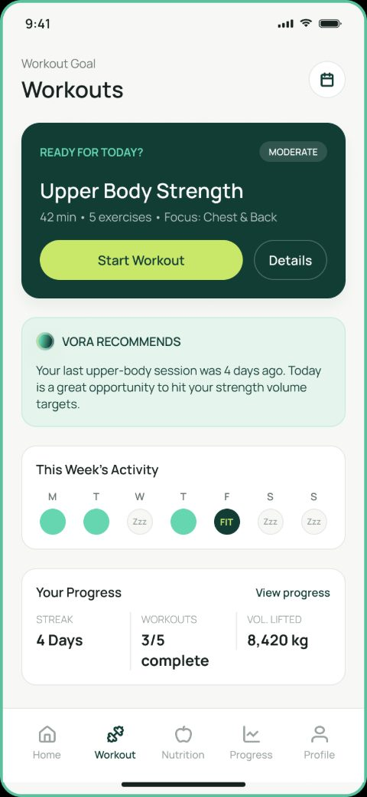 | 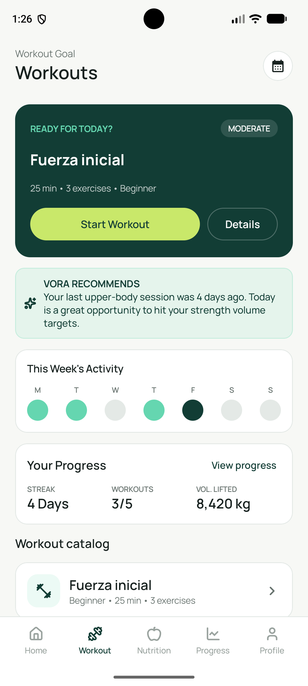 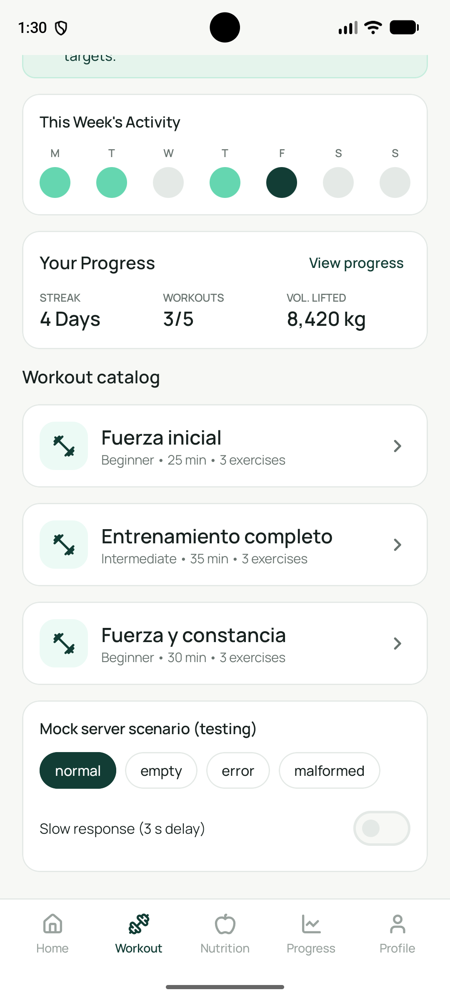 |
| 2 | 6.2 Progress Dashboard | 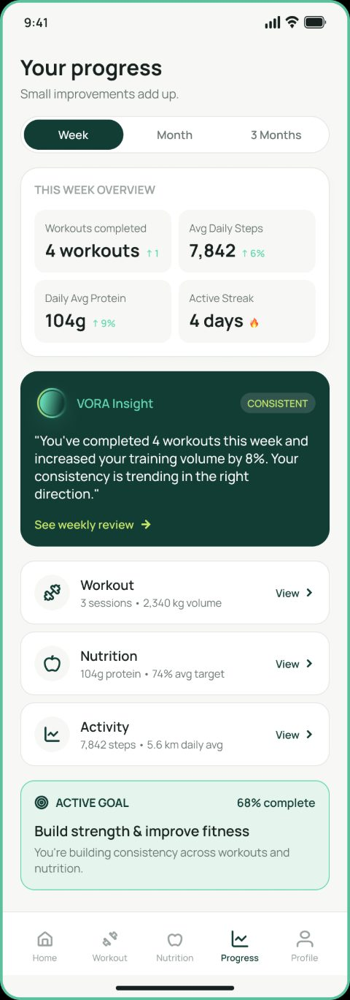 | 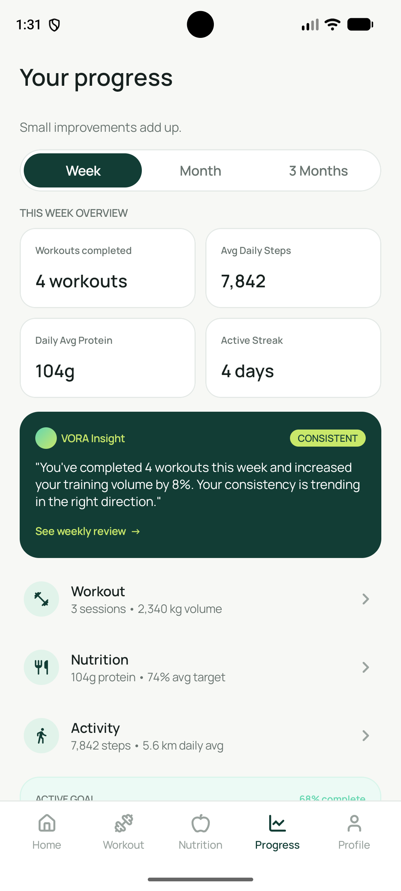 |
| 3 | 5.1 Nutrition Dashboard (funcional: comidas y totales del día en Room) | 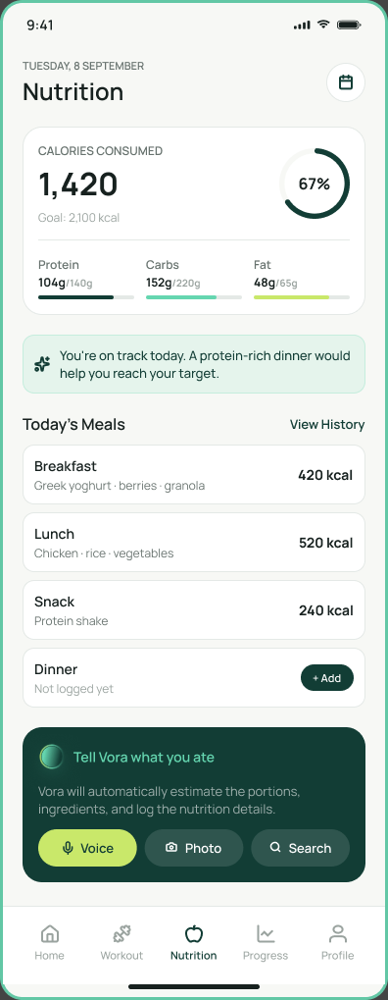 | 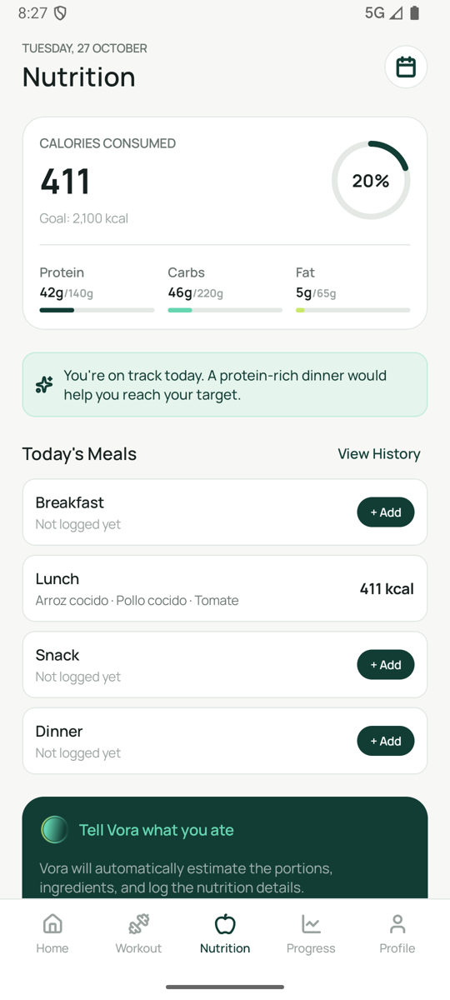 |
| 4 | 5.8 Meal Details (funcional: lectura y baja con confirmación en Room) | 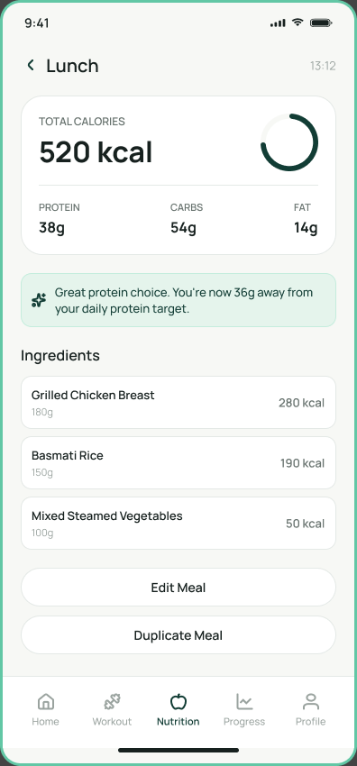 | 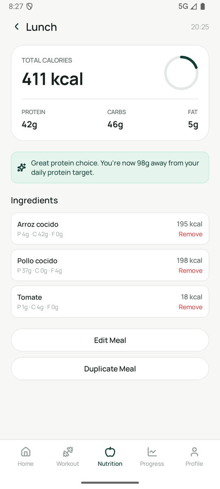 |
| 5 | 7.1 Profile Dashboard | 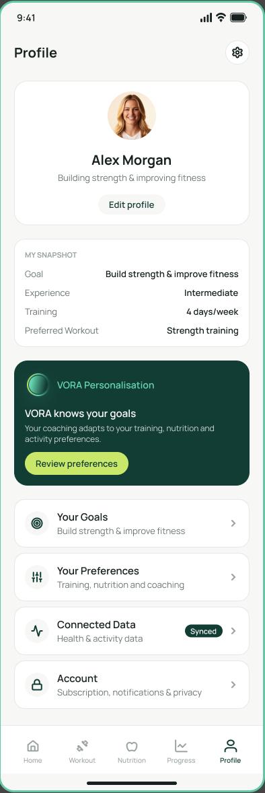 | 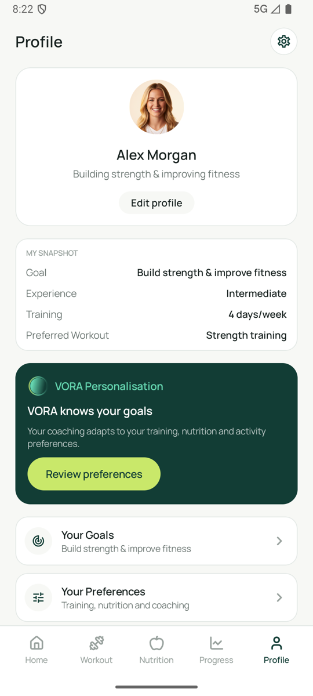 |
| 6 | 1.1 Login | 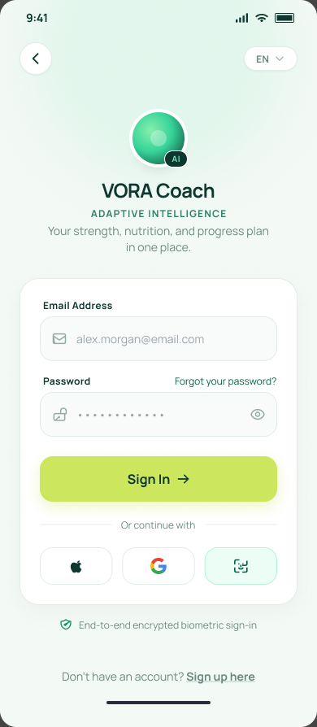 | 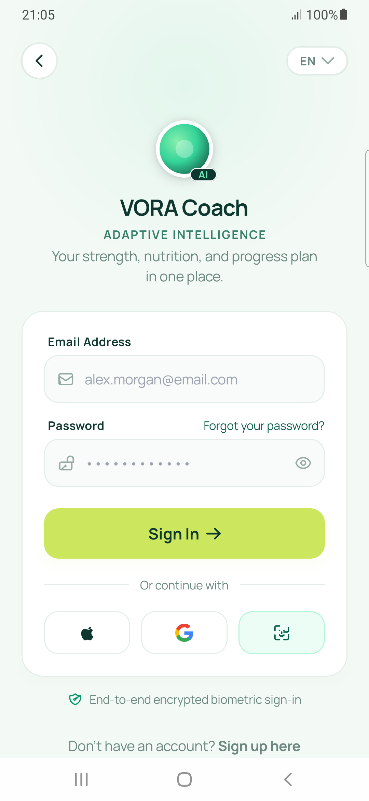 |
| 7 | 2.1 Home Dashboard | 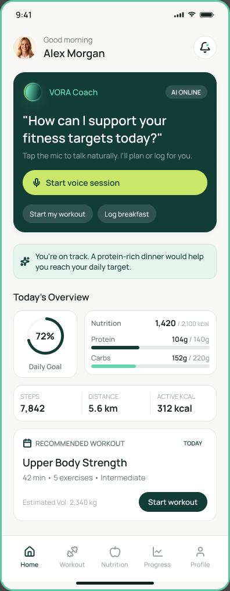 | 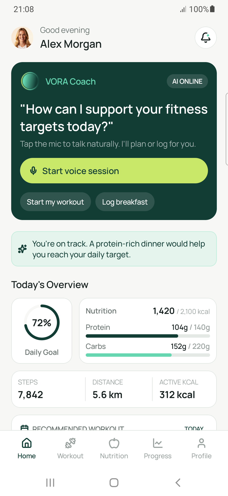 |
| 8 | 3.4 Voice Speaking (asistente respondiendo) | 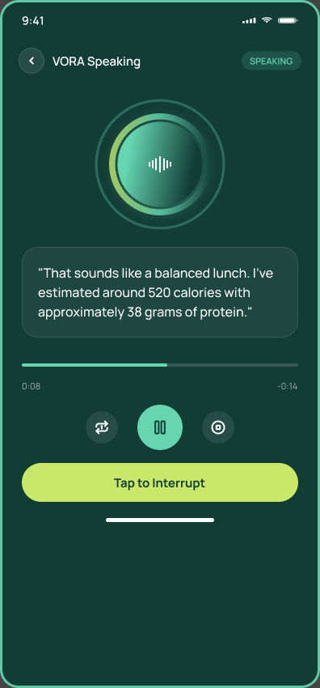 | 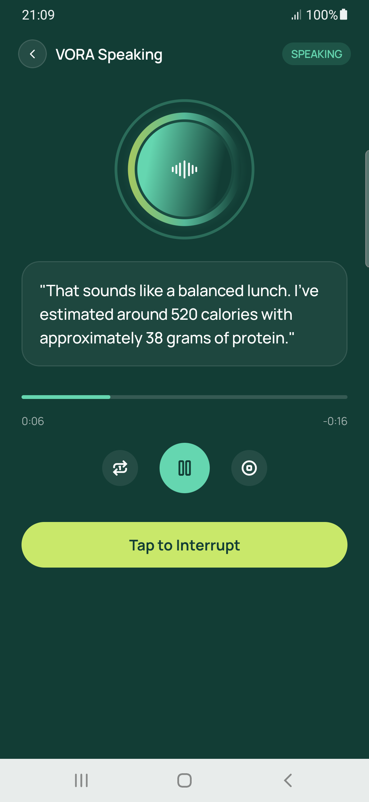 |

## 11. Video de demostración

Carpeta pública en Google Drive: **[VORA Coach TP3 video](https://drive.google.com/drive/folders/1NEIrqWFu07TWbekN0l2_b91wArmV5P5H)**

Grabado en el teléfono (Samsung Galaxy A50) contra el mock de `mock/`. Son cuatro clips sin audio porque
Android graba como máximo 3 minutos seguidos:

| Clip | Duración | Qué muestra |
|---|---|---|
| `01_login_registro_home.mp4` | 2:13 | Validaciones de Register y Login, ingreso, Home y Notifications |
| `02_asistente_de_voz.mp4` | 1:18 | Idle → Listening → Processing → Speaking, "Tap to Interrupt", Conversation y estado de Error |
| `03_workout_mock_y_room.mp4` | 2:25 | Catálogo y detalle desde el mock, escenarios `empty`, `error` y `malformed`, detalle leído de Room sin conexión |
| `04_nutricion_progreso_perfil.mp4` | 1:56 | Comida registrada por voz y guardada en Room, Progress, Profile y Log out |

## 12. Pruebas realizadas

Probado el 27/10/2026 en un **Samsung Galaxy A50** (Android 11) conectado por USB, contra el mock de `mock/`
(`adb reverse tcp:8000 tcp:8000`). Las pruebas de la app se hicieron con un script que maneja el teléfono por
`adb` y verifica los textos de cada pantalla. No hubo cierres inesperados (log de crashes vacío).

| Área | Qué se comprobó | Resultado |
|---|---|---|
| Mock | `python test_server.py` | 12/12 OK |
| Build | `./gradlew assembleDebug` | Compila (solo 2 avisos de íconos obsoletos en `AppSettingsScreen`) |
| Flujo 1 · Acceso | Errores de email vacío o inválido y contraseña corta; ingreso válido; Atrás desde el Home no vuelve al Login; Register valida el nombre y Atrás vuelve al Login | 9/9 |
| Flujo 2 · Home | Home, Notifications, "Mark all as read" y Atrás | OK |
| Flujo 3 · Asistente | Idle → Listening → Processing → Speaking (automático), "Tap to Interrupt", Conversation, Error al no detectar voz, "Not Now" y cierre del asistente | OK |
| Flujo 4 · Workout (RF01, RF02, RF05) | Catálogo y detalle desde el mock; `empty` → estado vacío; `error` y `malformed` → banner offline con los datos guardados en Room; detalle ya abierto visible offline; sin servidor y sin caché → error con "Try again"; al volver el servidor, "Try again" recupera el catálogo | OK |
| Flujo 5 · Nutrición (RF03, RF04) | Voice → análisis → confirmación guarda la comida en Room y el Dashboard la suma; la comida sigue guardada al cerrar y reabrir la app | OK |
| Flujos 6 y 7 | Progress Dashboard; Profile; Log out con confirmación vuelve al Login y Atrás no regresa a la app | OK |

## 13. Preguntas de la entrega

### Pregunta 3: ¿Qué arquitectura usaron y por qué? ¿Podría mejorarla?

* **Qué usamos:** Clean Architecture simplificada con MVVM e inyección de dependencias con Hilt. Separamos en
  cuatro capas: UI en Compose, ViewModels con `StateFlow`, Repositorios (que deciden si ir a la red o a la base
  local) y fuentes de datos con Retrofit y Room. Además, cada capa tiene su propio modelo (DTO, Entity y dominio)
  conectados con mappers (`toDomain()`, `toEntity()`).
* **Por qué la elegimos:** Cada clase tiene una sola responsabilidad, el estado sobrevive a la rotación de
  pantalla, el repositorio resuelve el modo offline leyendo de Room si cae la API, y nos permitió trabajar a los
  tres en paralelo sin pisarnos en Git.
* **Cómo la mejoraríamos:**
  1. Agregar interfaces en los repositorios y casos de uso (`UseCases`) para poder inyectar fakes y hacer tests
     unitarios.
  2. Hacer que Room sea la única fuente de verdad exponiendo un `Flow` continuo en lugar de lecturas puntuales
     con `Result`.
  3. Mover `DemoData` detrás de repositorios y, si la app crece, modularizar por feature (`:feature:workout`,
     `:feature:nutrition`).

### Pregunta 4: ¿Tuvieron objetos stateful y stateless? ¿Cómo definen la elección?

* **Stateless (sin estado):** Casi todas las pantallas y los componentes de `ui/components/`. Aplicamos state
  hoisting: solo reciben el `uiState` y avisan eventos con lambdas, lo que nos permite reutilizarlos y verlos en
  `@Preview` sin levantar Hilt ni ViewModels.
* **Stateful (con estado):** Los ViewModels (que guardan el `MutableStateFlow`), los destinos del `NavGraph` (que
  instancian el ViewModel con `hiltViewModel()` y observan con `collectAsStateWithLifecycle()`) y estados visuales
  locales manejados con `remember` o `rememberSaveable` (como el texto tipeado en Login, el botón de ocultar
  contraseña o las animaciones del Coach).
* **Criterio:** Si el dato es de negocio, se comparte entre pantallas (como `AuthViewModel`) o debe sobrevivir a
  cambios de configuración, va al ViewModel. Si es un detalle visual interno de una sola pantalla, va en el
  Composable con `remember`. El resto es siempre stateless.

### Pregunta 5: Mejoras y efectos si escala el volumen de datos

* **Pasar todas las listas a Lazy:** En `DailyMealsScreen` usamos `Column` con `verticalScroll` y `forEach`, que
  dibuja todo en memoria de golpe. Con cientos de comidas se trabaría; hay que pasarlo a `LazyColumn` con `key`,
  como ya hicimos en el catálogo de entrenamientos.
* **Paginación y caché incremental:** Hoy descargamos todo el catálogo junto y pisamos la tabla entera en Room. A
  gran escala usaríamos Paging 3 con `RemoteMediator`, actualizaciones con `@Upsert` y tiempo de expiración para
  la caché.
* **Migraciones en Room:** Tenemos `fallbackToDestructiveMigration(true)`, que si cambia la base de datos borra
  las comidas cargadas por el usuario. Para producción hay que activar `exportSchema = true` y programar las
  clases `Migration`.
* **Lo que ya escala bien:** Los totales diarios de nutrición se calculan directamente en SQLite (`SUM` en
  `MealDao.observeDailyTotals`) y no recorriendo la lista en Kotlin.

### Pregunta 6: Manejo de errores, dónde está en el código y estrategia de mapeo

* **Dónde está:** En el Repositorio. `WorkoutRepository` valida `response.isSuccessful` y distingue códigos HTTP
  (`404` no existe, `503` servidor no disponible), mientras que con `runCatching` atrapamos cortes de red o fallos
  de parseo cuando el mock devuelve un JSON malformado (que llega con HTTP 200 pero falla al leerse).
* **Respaldo y validación:** Si la API falla, el repositorio lee Room y devuelve `CachedData(isFromCache = true)`
  para mostrar los datos junto al banner offline, sin borrar nunca la caché válida previa. En los mappers usamos
  `mapNotNull` para descartar ítems corruptos sin romper toda la lista, y los formularios se validan en el
  ViewModel.
* **Mejora en el mapeo:** Hoy el repositorio devuelve el mensaje de error ya armado en texto y `runCatching`
  captura también `CancellationException`. Lo ideal es atrapar solo excepciones esperadas (`IOException`,
  `HttpException`, `JsonParseException`) y devolver una `sealed interface DataError` (`Network`, `NotFound`,
  `Server`, `Parsing`) para que la UI elija el texto a mostrar.

### Pregunta 7: ¿Cómo la pasarían a español conservando el inglés? ¿Y otros idiomas?

* **Recursos de strings:** Extraer los textos fijos de los composables a `res/values/strings.xml` (inglés por
  defecto) y agregar `res/values-es/strings.xml` (español), llamándolos con `stringResource`,
  `pluralStringResource` y placeholders (`%1$s`, `%1$d`).
* **Formatos y errores:** Usar `NumberFormat` y `DateTimeFormatter` para que números (de `1,420 kcal` a
  `1.420 kcal`) y fechas cambien solos según el `Locale`, y mapear los `DataError` del repositorio a textos de
  `strings.xml` en la UI.
* **Selector en la app y servidor:** Conectar el botón `"EN"` del Login a
  `AppCompatDelegate.setApplicationLocales(...)` configurando `locales_config.xml`, y sumar el header
  `Accept-Language` en el interceptor de OkHttp para que la API devuelva el contenido ya traducido.
